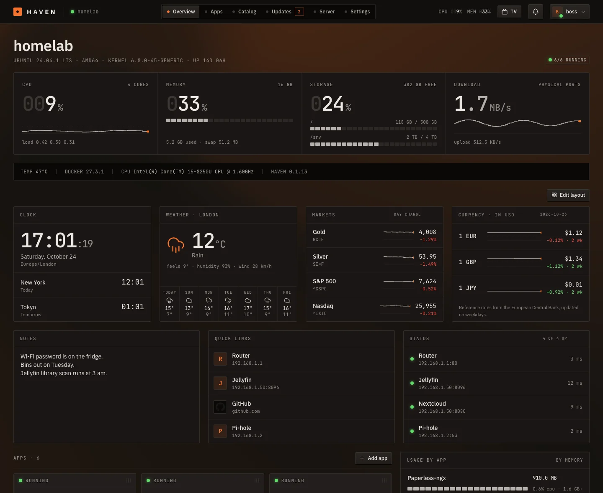
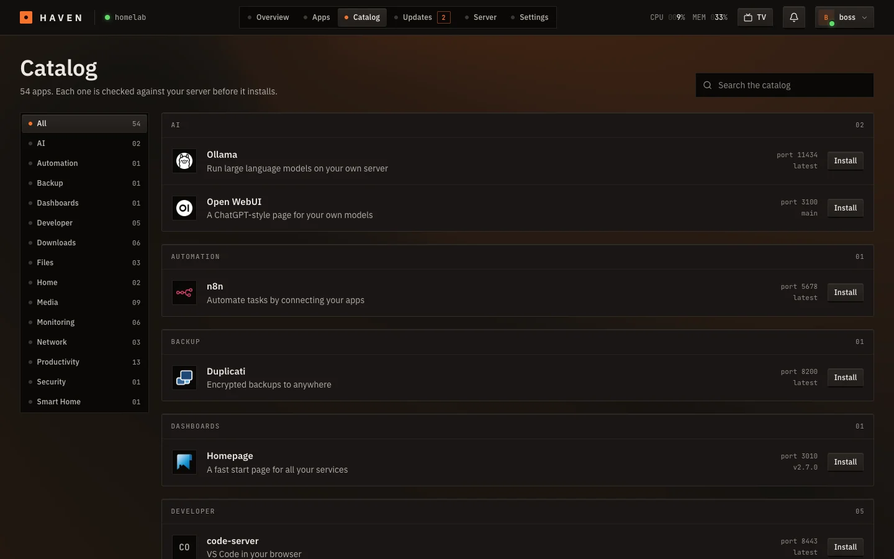
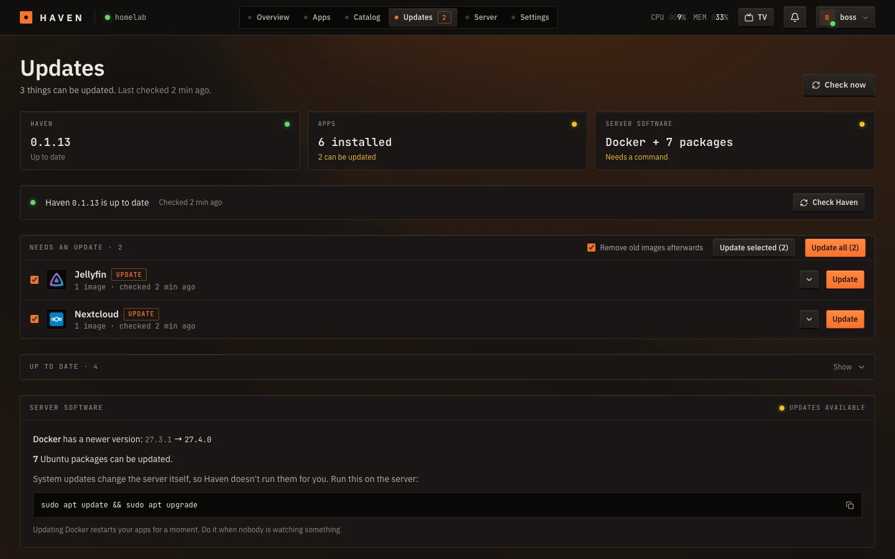
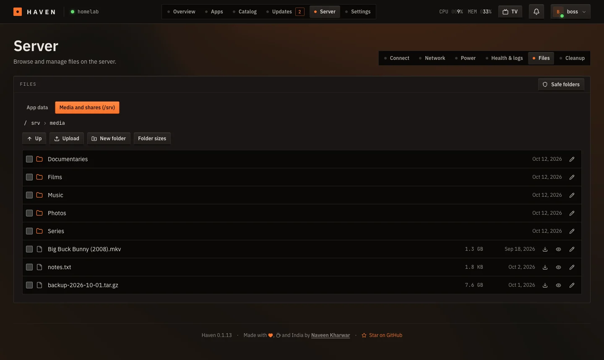
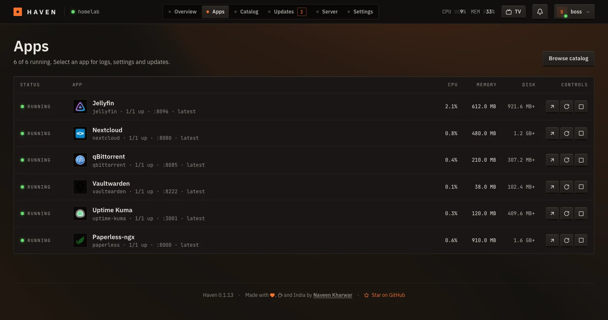
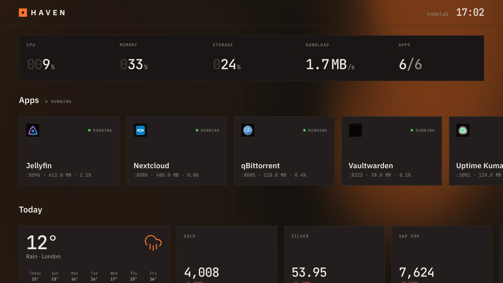
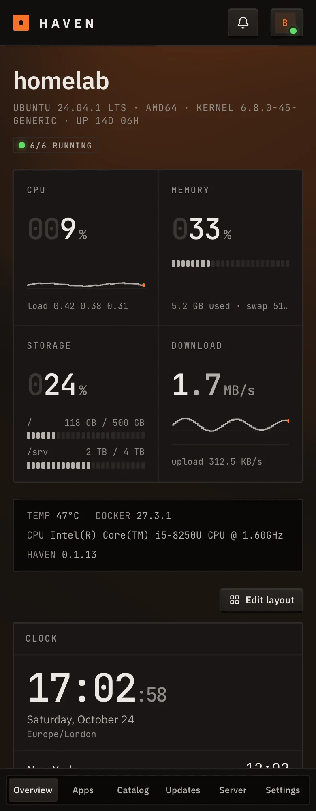

# Haven

A home server manager for Ubuntu. Install apps from a catalog, keep them updated, and look after the server from a web page. When something fails, Haven says what happened and gives you the command to fix it.



Haven is one program. Your apps are ordinary Docker Compose projects, so if you stop Haven they keep running and you can manage them by hand.

## Features

- **App store:** 54 self-hosted apps. Each one is checked against your server (ports, disk, RAM, CPU type) before it installs.
- **Clear errors:** a failed install or update explains the cause, and every app has a Diagnose button.
- **Safe updates:** apps and Haven itself update with one click and roll back if the new version doesn't start. Haven's own releases are signed.
- **Overview:** eight widgets you can rearrange: clock, weather, markets, currency, news, notes, quick links and status checks for your router or apps.
- **Server tools:** remote access with Tailscale, a `haven.local` address, Wi-Fi and network settings, lid and power control, a health check, a file explorer and disk cleanup.
- **People:** one admin, plus managers, members and guests who see only the apps you share.
- **TV mode:** a remote-friendly screen that you sign in to with a code from your phone.

## Screenshots

| | |
|---|---|
|  |  |
|  |  |

| TV mode | Phone |
|---|---|
|  |  |

## Install

You need Ubuntu or Debian with systemd (Intel/AMD or ARM) and a user with `sudo`. Haven installs Docker if it is missing.

```bash
curl -fsSL https://github.com/NaveenKharwar/Haven/releases/latest/download/get.sh | sudo bash
```

The script downloads the newest release, checks it against the release's checksums, installs the service, and prints the address and a one-time setup code. Open the address, enter the code, and create the admin account. The code is also in `/opt/haven/setup-token` until the account exists.

To read the script before running it, save it first with `curl -fsSLO <same address>`, then `sudo bash get.sh`. For another port or a specific version (0.1.15 or newer), put `HAVEN_PORT=9000` or `HAVEN_VERSION=0.1.15` after `sudo`. You can also unpack `haven-<version>.tar.gz` from the [Releases page](../../releases) and run `sudo ./install.sh`.

If the server runs `ufw`, allow the port with `sudo ufw allow 8484/tcp`.

**Update:** press Update on the Haven card on the Updates page, or run the install command again.

**Remove:** `curl -fsSL <same address> | sudo bash -s -- uninstall`. Your apps and data stay.

## Remote access and people

**Server → Connect** installs Tailscale and shows a sign-in link. After that Haven is reachable from your devices anywhere. To let someone else in, share the server with them in the Tailscale admin console and create their account under **Settings → People**. Tailscale decides who can reach Haven, and the role decides what they can do.

| Role | Can do |
|---|---|
| Admin (only one) | Everything |
| Manager | Install and manage apps, use Files in the safe folders |
| Member | Open and restart the apps they are given |
| Guest | Open the apps they are given |

For TV mode, open `http://SERVER_IP:8484/tv` in the TV's browser. The TV shows a six-letter code. Type it under **Settings → TV** on your phone and the TV signs itself in.

## Security

Haven runs as root, so treat it like the keys to your server.

- Don't expose its port to the internet. Use Tailscale or another VPN.
- The setup code stops others on your network from claiming a fresh install. Passwords use bcrypt, and five wrong logins lock an address out for five minutes.
- The server enforces roles on every request. The file explorer opens only app data and `/srv` unless the admin accepts a warning, and system folders can't be deleted.
- Updates are verified with a signature and a checksum before they install.

To report a vulnerability, see [SECURITY.md](SECURITY.md).

## Where things live

- The program is `/usr/local/bin/haven`, run by systemd as `haven.service`. Logs: `journalctl -u haven`.
- Each app is a folder, `/opt/haven/apps/<id>/`, holding `compose.yml` and `.env`. Its data is in `/opt/haven/appdata/<id>/`.
- Haven's own state is a few small JSON files in `/opt/haven`.

## Develop

You need Go and Node. The program embeds the built interface, so build it first:

```bash
cd web && npm ci && npm run build && cd ..
```

```bash
go run . --data ./dev-data     # API and built interface on :8484
cd web && npm run dev           # live-reload interface on :5173
go test ./...                   # tests, including catalog validation and role checks
bash scripts/test-get.sh        # tests the one-line installer
./build.sh                      # tests, then builds release/haven-<version>.tar.gz
./deploy.sh you@SERVER_IP       # build, copy and install on your server
```

To add an app to the store, copy a file in `catalog/` and edit it. `go test` rejects mistakes such as an undefined `${VAR}`, a missing image tag, or a port another app already uses. Built-in variables: `APP_DATA`, `PUID`, `PGID`, `TZ`. The visual style is described in [design.md](design.md). Maintainers publish releases as described in [docs/RELEASING.md](docs/RELEASING.md).

## Roadmap

- Backups and restore, with a schedule and a one-click restore
- Domains and automatic HTTPS for each app
- A web terminal
- Alerts in plain words: a filling disk, a failing drive, an app that keeps crashing
- Device history on the Insights page, and a heads-up when an unknown device appears at night
- Export and import of Haven's own settings (widgets, people, device names)
- Search everywhere with Ctrl/Cmd+K
- More store apps

## Licence

MIT. See [LICENSE.md](LICENSE.md).

## Credits

Made with love, coffee and India by [Naveen Kharwar](https://github.com/NaveenKharwar). If Haven is useful to you, a star on GitHub helps others find it. Data sources, libraries and fonts are credited in **Settings → About**.
