# Set up a website in Haven

Start with a Haven server that does not yet have Coolify. You will install Coolify, connect it to Haven, and install WordPress, Ghost or a static HTML site privately. Modern frameworks and custom applications can be deployed through Coolify. Publishing is optional and comes last. Account details and IDs in screenshots are hidden or replaced with examples; your names will be different.

**Preview:** Hosting is experimental. Test on a disposable server first; see the [verification record](HOSTING_TESTING.md) for remaining gaps.

## Before you start

1. Have Haven installed and sign in as its administrator. Haven and Coolify must run on the **same** Linux server, with Haven running as root. For your first try, use a disposable VM, not your production server.
2. Check the server has at least **2 CPU cores, 2 GB RAM and 10 GB free on the root disk**. These are minimums: **4 GB RAM or more is recommended**, plus memory and disk for every website, build and database. Haven also warns when available memory is low, swap is heavily used or current system load is high. Check the filesystem holding `/data`, too. The server needs working Docker Engine **28 or later**, its Compose plugin, and a running SSH server.
3. On your own computer, have a terminal and an SSH login to that server: its username, private address, and password or SSH key. Ask whoever set up the server if you do not know them. For Docker installation, see [Docker's installation guide](https://docs.docker.com/engine/install/).
4. If you later want a public address, have a domain you own already active in Cloudflare. You do **not** need a domain or Cloudflare to install and use a private site.

## 1. Enable Hosting and open it

Hosting is an experimental preview. On a systemd-based Haven server, enable it once:

1. On your computer, open a terminal and SSH into the server with your usual login: `ssh SSH_USER@SERVER_ADDRESS`. Replace both placeholders with your own details.
2. Check for an existing setting before creating the dedicated drop-in:

   ```sh
   sudo test ! -e /etc/systemd/system/haven.service.d/hosting.conf || sudo cat /etc/systemd/system/haven.service.d/hosting.conf
   sudo grep -Rns --include='*.conf' 'HAVEN_HOSTING_EXPERIMENTAL' /etc/systemd/system/haven.service.d 2>/dev/null || true
   ```

   A clean installation prints nothing. If `hosting.conf` already exists with exactly the configuration shown in the next step, it is safe to continue. If it contains anything else, do not overwrite it: preserve a backup and move unrelated settings to their own descriptively named drop-in first. If the second command shows a previous `override.conf`, do not delete that file because it may contain other settings. When the matching line contains only the Hosting environment assignment, migrate it non-interactively while preserving a backup and every other line:

   ```sh
   legacy=/etc/systemd/system/haven.service.d/override.conf
   sudo cp -a "$legacy" "$legacy.before-hosting"
   sudo sed -Ei '\|^[[:space:]]*Environment="?HAVEN_HOSTING_EXPERIMENTAL=[^"[:space:]]+"?[[:space:]]*$|d' "$legacy"
   ```

   Run the check again. Resolve any remaining assignment in another drop-in before continuing so a later file cannot override `hosting.conf`. Back up that file and remove only the standalone Hosting assignment; preserve its other settings.
3. Create the dedicated configuration, reload systemd and restart Haven:

   ```sh
   sudo mkdir -p /etc/systemd/system/haven.service.d
   printf '[Service]\nEnvironment=HAVEN_HOSTING_EXPERIMENTAL=1\n' | sudo tee /etc/systemd/system/haven.service.d/hosting.conf >/dev/null
   sudo systemctl daemon-reload
   sudo systemctl restart haven
   ```

   The restart briefly disconnects the dashboard. Verify the service and effective setting:

   ```sh
   sudo systemctl is-active haven
   sudo systemctl show haven --property=Environment --value | tr ' ' '\n' | grep -x 'HAVEN_HOSTING_EXPERIMENTAL=1'
   ```

   The expected output is:

   ```text
   active
   HAVEN_HOSTING_EXPERIMENTAL=1
   ```

4. Sign in to Haven as an administrator and select **Hosting** in the top navigation. If you are not an administrator, ask the Haven administrator to complete these steps.

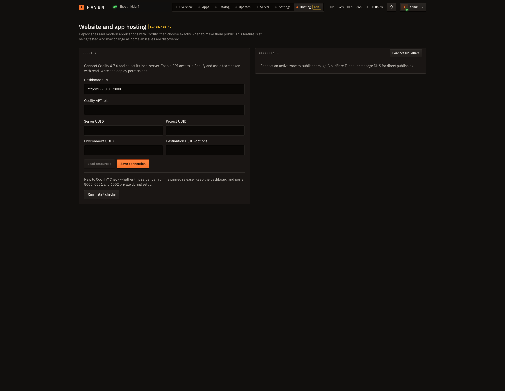

If the page says **Hosting is off**, repeat the verification commands and use `sudo systemctl cat haven` to look for a later conflicting assignment. If your Haven installation does not use systemd, ask its administrator how to set the environment variable for the Haven service.

To disable the preview, remove only its dedicated drop-in, reload systemd and restart Haven:

```sh
sudo rm -f /etc/systemd/system/haven.service.d/hosting.conf
sudo systemctl daemon-reload
sudo systemctl restart haven
sudo systemctl is-active haven
if sudo systemctl show haven --property=Environment --value | tr ' ' '\n' | grep -q '^HAVEN_HOSTING_EXPERIMENTAL='; then
  echo 'A different drop-in still sets HAVEN_HOSTING_EXPERIMENTAL'
else
  echo 'Hosting override removed'
fi
```

The expected output is `active` followed by `Hosting override removed`. If another drop-in still sets the variable, back up that file and remove only its stale Hosting assignment; do not remove unrelated service settings.

On a new server, the Coolify connection fields appear before Coolify is installed. Leave them empty for now; use **Run install checks** below them. Website platforms appear after Coolify is connected.

## 2. Install Coolify

Haven installs the supported Coolify version for you. You do not need to install it separately.

1. Under **Coolify**, select **Run install checks**.
2. Read each result. A red result blocks installation; an amber result warns about current capacity or identifies a partial installation. Fix blocked checks and reduce memory, swap or load pressure before continuing. For example, if Haven uses port 80, open **Server → Local address**, turn off **Also answer on port 80**, and return to Hosting. Ports 80, 443, 6001, 6002 and 8000 must be free for a new installation.

   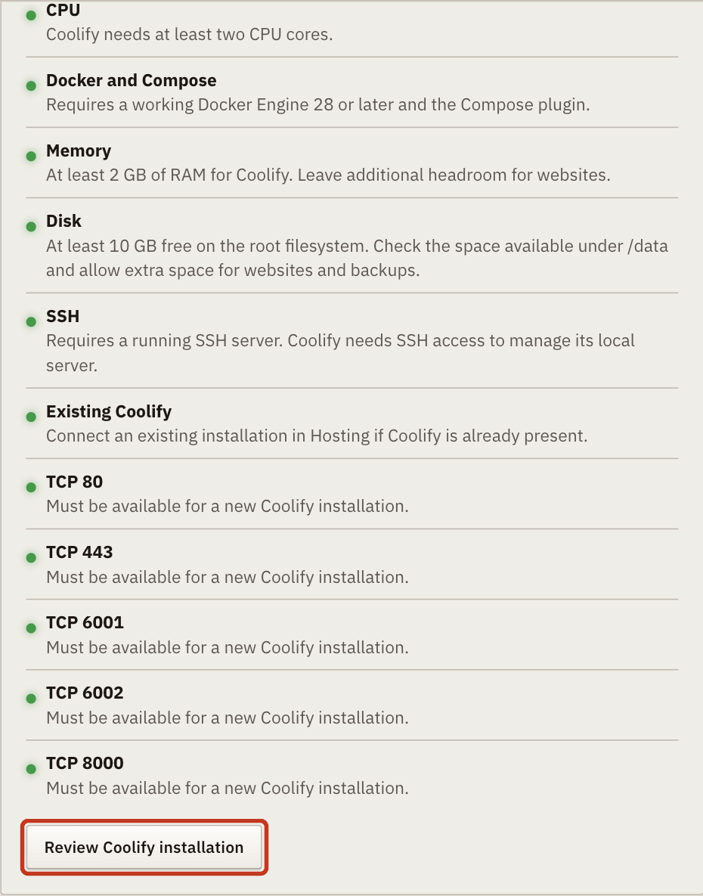

3. When all checks pass, select **Review Coolify installation**. Read the confirmation: the installer starts platform containers and configures local SSH access for deployments.

   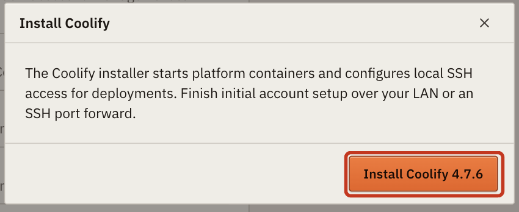

4. Select **Install Coolify**. Haven streams the installer progress and allows up to 30 minutes for slow image downloads. Do not close or restart the server during installation. If Haven detects files from an interrupted setup, rerun the checks and use **Review installation recovery → Resume installation**. It reruns the same pinned installer without deleting Coolify data.

Keep ports 8000, 6001 and 6002 private; do not forward them on your router. Create the first Coolify account promptly, because anyone who can reach its registration page may be able to claim it.

## 3. Open Coolify and create an account

1. On your own computer, open Terminal (macOS/Linux) or Windows Terminal. Run the command below, replacing `SSH_USER` with your server login username and `SERVER_ADDRESS` with your server's private IP or SSH address. For example, if the username is `alex` and the private address is `192.168.1.20`, the end of the command is `alex@192.168.1.20`.

```sh
ssh -N -L 127.0.0.1:8000:127.0.0.1:8000 SSH_USER@SERVER_ADDRESS
```

2. If SSH asks you to verify the server fingerprint, check it with your server administrator before accepting. Sign in if prompted. Leave this terminal open: it keeps a private connection to Coolify. A blank terminal is normal.
3. On the **same computer**, open [http://127.0.0.1:8000](http://127.0.0.1:8000). This address reaches Coolify through the SSH connection, not through a public router port.
4. Create your Coolify administrator account with your own name, email and a strong password. Save the password securely; it is separate from your Haven login.
5. In the welcome screen, select **Continue**, then **This machine**. This selects the Linux server running Haven and Coolify.
6. At **Project Setup**, select **Create "My First Project"**. Coolify creates a project and a production environment for your websites.

   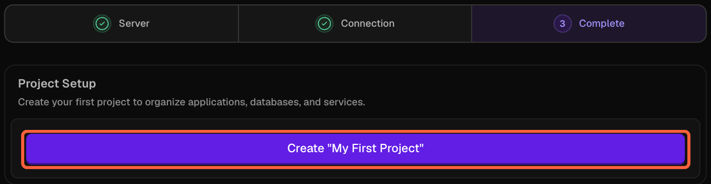

7. On **Setup complete**, check that the server is **localhost** and the production environment is ready. Select **Go to dashboard**. Remember the project name for the Haven connection.

If the page does not open, check that the install job finished and the SSH terminal is still connected. If the registration page says the setup window closed, see [Coolify's setup instructions](https://coolify.io/docs/start-with-self-hosted#2-access-the-dashboard). Do not expose the dashboard to the internet to complete setup.

## 4. Enable the Coolify API

1. In Coolify, open **Settings → Advanced**.
2. Under **API and MCP**, set **API access** to **Enabled**.

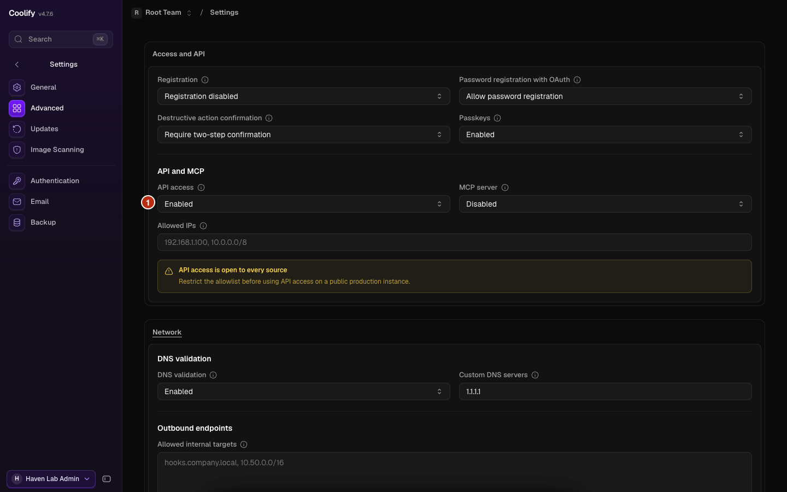

## 5. Create a Coolify API token

1. In Coolify, open **Keys & Tokens → API Tokens**.
2. Select **New token**.

   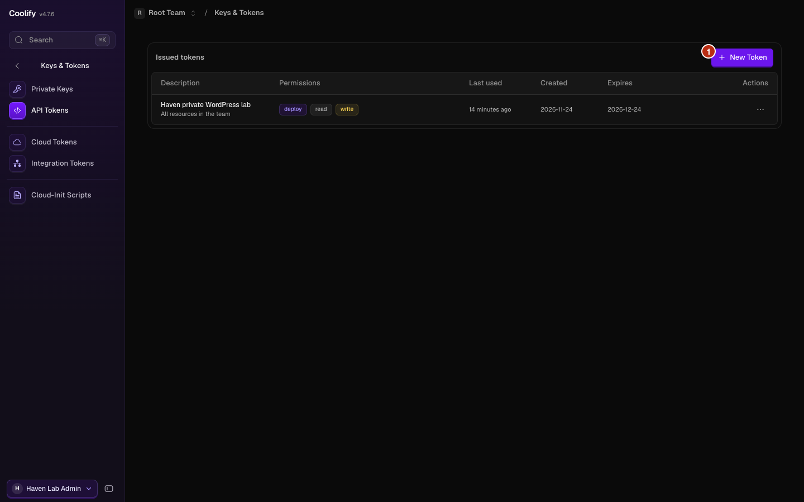

3. Enter a description, such as `Haven integration`.
4. Under **Permissions**, select **Read**, **Write**, and **Deploy**. Leave the other permissions unchecked.
5. Under **Access**, choose access to the team resources Haven will manage. Select an expiration and keep a reminder to rotate the token before it expires.

   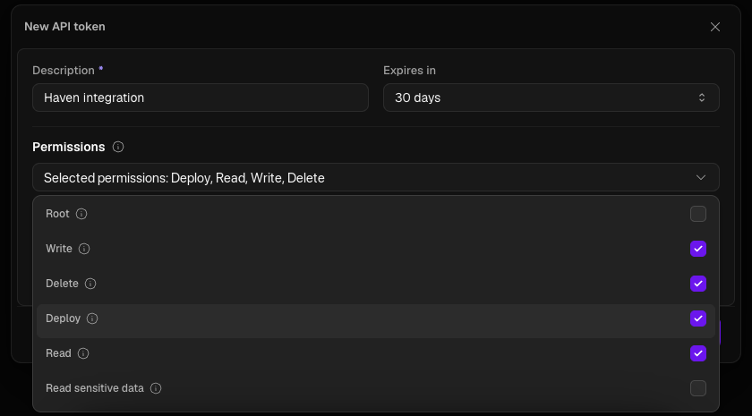

6. Select **Create token**.
7. Copy the token from the window that appears. Keep it available for the next step. Coolify shows the full token only once.

Treat this token like a password.

## 6. Connect Coolify in Haven

Return to **Haven → Hosting**.

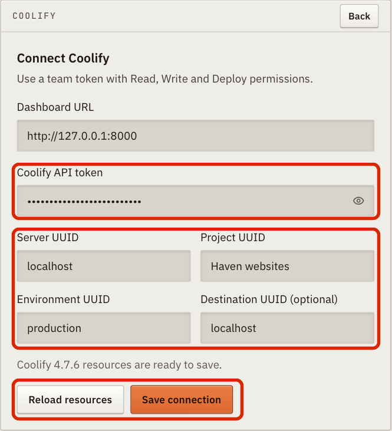

1. **Dashboard URL** — leave `http://127.0.0.1:8000`. Haven uses this address on the server itself; it is not your site's public address.
2. **Coolify API token** — paste the token you just copied.
3. Select **Load resources**. Choose the local server, usually **localhost**, and your project.
4. Select **Load resources** again. Choose the environment, usually **production**. Choose a destination if one is offered.
5. Select **Save connection**.

The server is the machine running Coolify; the project groups its resources; the environment is the workspace inside that project. The optional destination is where Coolify runs the service. Haven loads these from Coolify, so you do not need to type their UUIDs when the lists load. If discovery fails, confirm API access is enabled and the token has the permissions above.

## 7. Install your website

1. Under **Sites and apps**, find **WordPress + MariaDB**, **Ghost**, or **Static HTML**.
2. Select **Install privately**.
3. Enter a website name and select **Confirm private install**.
4. For Static HTML, paste a complete HTML document. Wait while Haven reports **Queued**, **Deploying**, then **Ready**. Haven now keeps the install job open until the private web container answers HTTP. If deployment fails or reaches the deadline, fix the error and select **Retry install** on the site card; Haven reuses the existing Coolify service.

A successful Haven job means the private website answered from the expected loopback-only container and dedicated network. Select **Check website** for its current status. Open Coolify for detailed build and container logs.

For React, Next.js, Vue, Nuxt, SvelteKit, Astro and other modern frameworks, use **Open Coolify** in the modern-framework panel. Coolify can build a Git repository with its detected build pack or a repository Dockerfile. It can also deploy an existing Docker image or an advanced Docker Compose definition. These resources remain managed in Coolify and are not automatically adopted into Haven's guided publishing workflow. Review their ports, domains, secrets and persistent storage in Coolify before making them public.

## 8. Open the site privately

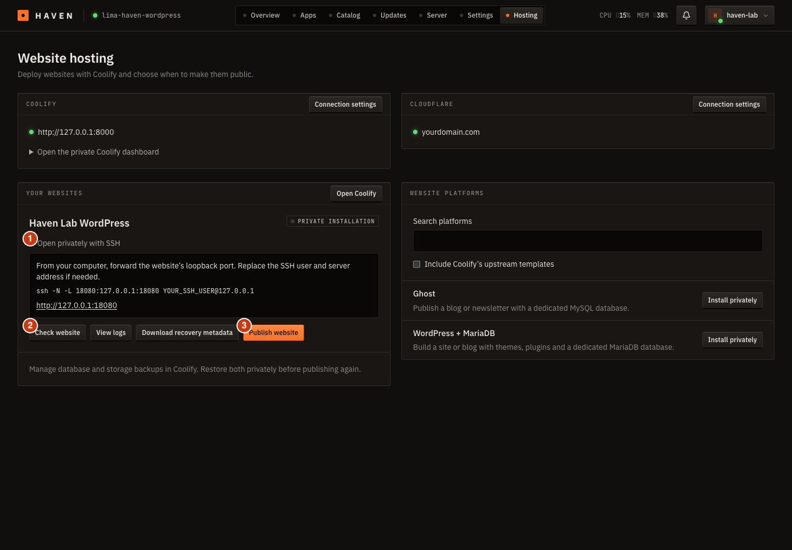

1. On your website card, open **Open privately with SSH**.
2. Copy the command shown there into a terminal on your computer. Replace `YOUR_SSH_USER` and the server address with your SSH login details. Run it and sign in if prompted.
3. Leave that terminal open and open the displayed local URL in a browser on the same computer. Close the terminal when you finish; rerun the command next time you want private access.
4. Complete WordPress or Ghost setup and create your website administrator account.

For Ghost, open the local URL followed by `/ghost/`. Ghost needs working transactional email to send verification codes for new administrator devices. Set this up before relying on the site. See [Ghost verification email](HOSTING.md#ghost-verification-email).

Your website is private at this point. Continue only if you want to publish it.

## 9. Prepare Cloudflare

For a Cloudflare Tunnel, your domain must already be an active zone in Cloudflare. A **zone** is the domain Cloudflare manages; a **hostname** is the address for this site. Choose an unused hostname such as `blog.example.com` under your own domain. Do not use the example literally.

### Create a Cloudflare API token

1. In Cloudflare, open **My Profile → API credentials → API tokens**, then select **Create token**.

   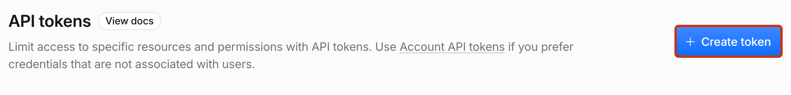

2. Enter a token name, such as `Haven website hosting`.
3. Under **Policies**, select **Start from scratch**, then **Start with an Account policy**.

   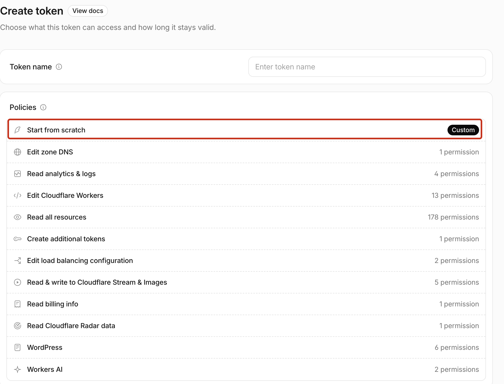

   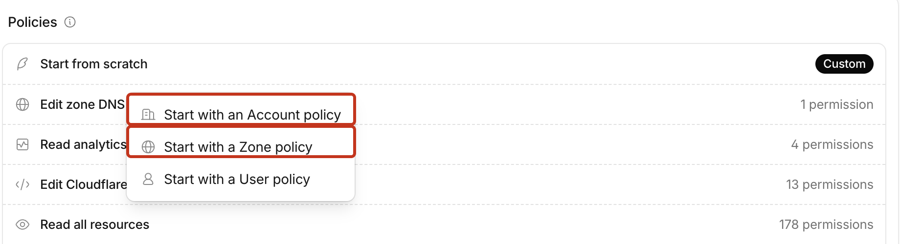


4. In the account policy, replace the default **All accounts** with only the account that owns your domain. Search the permission groups for **Cloudflare Tunnel** and check **Edit** on that row. Do not select unrelated permissions.

   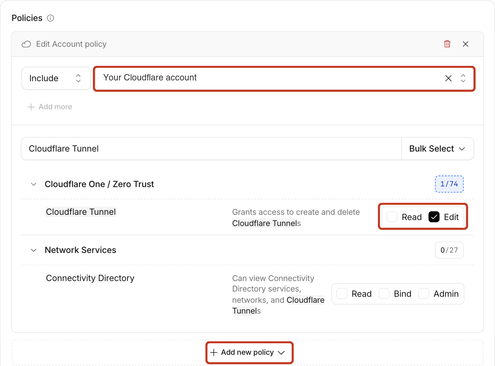

5. Select **Add new policy → Add new Zone policy**. Choose **Include → Specific zone**, then select only your domain. The account and zone need separate policies in the same token.
6. Search for **DNS** in the zone policy's permission groups. Under **DNS & Zones**, check **Edit** on the **DNS** row and **Read** on the **Zone** row. Leave unrelated groups unchecked.

   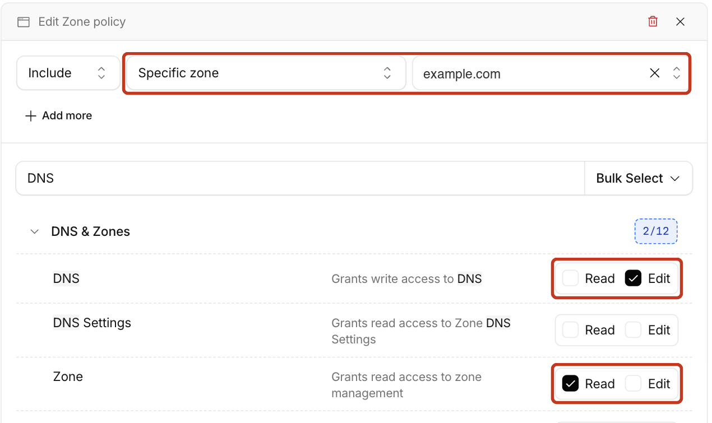

7. Choose an expiration and select **Continue to summary**. Check both policies, then select **Create Token**. Copy the secret when Cloudflare displays it; it is shown only once.

| Policy | Select | Permission |
| --- | --- | --- |
| Account | Your Cloudflare account | Cloudflare Tunnel → Edit |
| Zone | Your domain | Zone → Read |
| Zone | Your domain | DNS → Edit |

Treat the token like a password. Tunnel Edit can manage tunnels in the selected account, and DNS Edit can change DNS records throughout the selected zone—not just this hostname. Cloudflare's documented API accepts DNS Edit for the zone lookup too; Zone Read is included explicitly to match Haven's setup guidance, not claimed as a proven minimum. Account and zone discovery, Tunnel creation and configuration, connector-token retrieval, DNS ownership checks, and cleanup have passed the live API workflow with these scopes. Connector connectivity and public HTTPS still need automated end-to-end verification. See [permission details](HOSTING.md#cloudflare-tunnel).

### Connect Cloudflare to Haven

1. In Haven Hosting, select **Connect Cloudflare**.
2. Enter the root domain, such as `example.com`, and paste the **Cloudflare API token**. Haven discovers the matching Account ID and Zone ID; you no longer need to copy them from the dashboard.
3. Select **Save Cloudflare connection**.

Saving checks the zone connection. Haven checks the tunnel permissions when you publish.

## 10. Publish with Cloudflare Tunnel

1. On the site card, select **Publish website**.
2. Enter your hostname and choose **Cloudflare Tunnel**.
3. Select **Review publication**.

   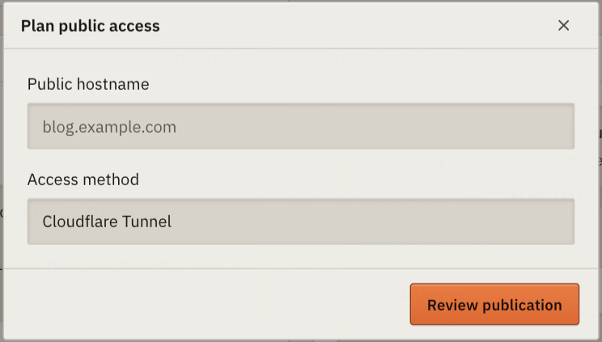

4. Check the website, hostname, access method and DNS change. This creates a public route and DNS record and changes the site's canonical URL. Back up existing content first; changing domains may require an application-aware migration. Select **Confirm publication** only when ready to make the site public.
5. Wait for the job, then select **Check website** to see the HTTPS status. Open the public address from a separate internet connection, such as mobile data with Wi-Fi and Tailscale off. Check the page, sign-in and images.

Cloudflare Tunnel uses an outbound connection from your server. Router port forwarding is not needed.

## 11. Unpublish

On the site card, select **Unpublish** and confirm. Haven removes its public route and DNS record while keeping the site and its data. Check the private SSH address again.

For direct publishing, backups, recovery, and troubleshooting, see the [technical guide](HOSTING.md). For what has been tested, see the [testing checklist](HOSTING_TESTING.md).
